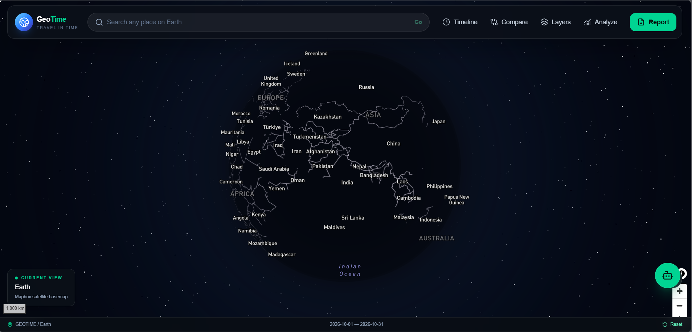
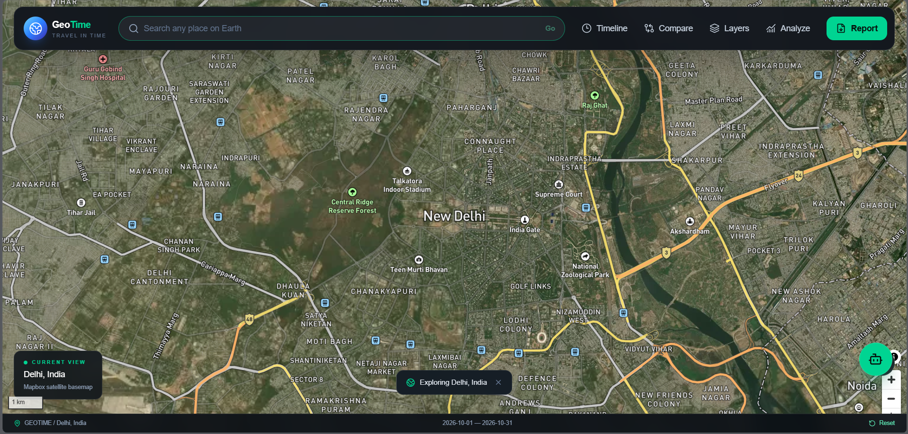
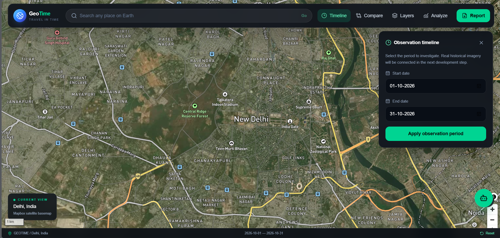
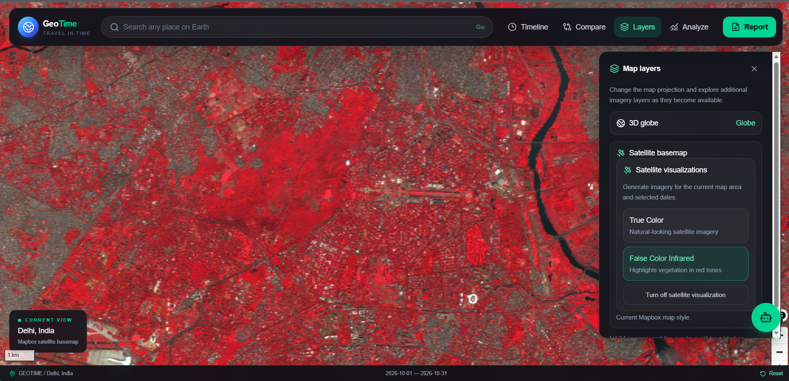
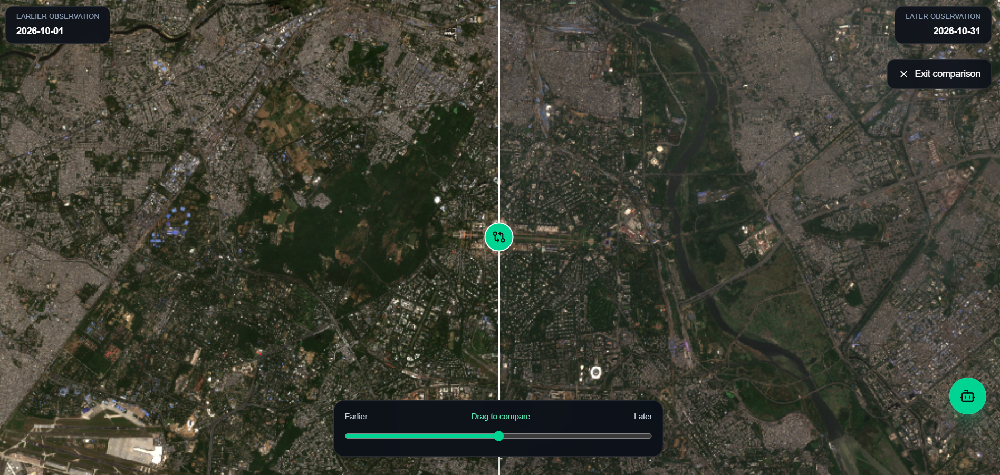
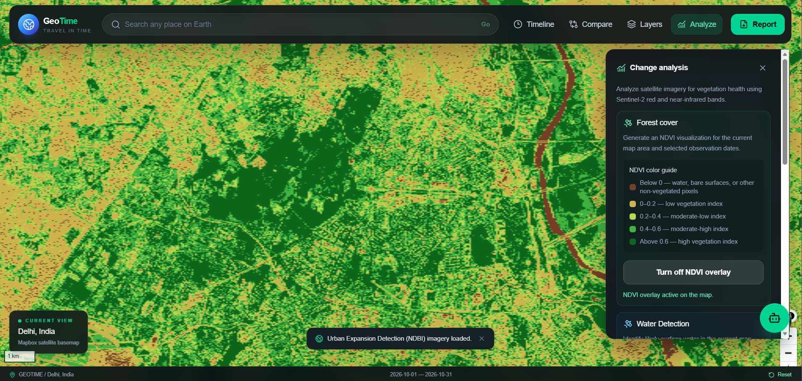

# GEOTIME
### Explore Earth. Across Time.

<p align="center">
  <em>
    A full-stack geospatial intelligence platform that turns raw satellite pixels
    into answers. Rewind the planet, measure vegetation, hunt water bodies,
    catch fire hotspots, and ask an AI what it all means.
  </em>
</p>

<p align="center">
  
  
  
  
  
  
  
  
  
  
</p>

<p align="center">
  <strong>The Earth never sits still. GeoTime shows you exactly how it moves.</strong>
</p>

---

# ABOUT

**GeoTime** is a full-stack geospatial intelligence platform built to explore, compare, and analyze Earth's changing landscapes through satellite imagery and environmental data.

Vegetation health. Shrinking lakes. Cities swallowing farmland. Fires lighting up the dark. GeoTime pulls every one of these signals into a single interactive workspace.

This is not a map you look at. It is a map you interrogate.

- What did this place look like years ago?
- How much greener, or browner, has it become?
- Is the city creeping outward?
- Where is the water growing, and where is it vanishing?
- Is anything burning right now?
- What are the satellites actually telling us?

GeoTime fuses satellite imagery, geospatial visualization, spectral indices, historical comparison, and AI-powered assistance, and converts a mountain of complex Earth observation data into something anyone can read.

It is more than a map.

**It is Earth's story, told through time.**

---

# THE PROBLEM

Our planet is changing, fast.

Forests vanish. Cities sprawl. Lakes shrink and swell. Wildfires tear through ecosystems.

And yet seeing these changes clearly is brutally hard.

The data you need is scattered across:

- Satellite imagery platforms
- Earth observation datasets
- Environmental monitoring systems
- Fire detection services
- Geospatial visualization tools
- Scientific analysis workflows

Which leaves you fighting with:

- Comparing satellite observations across different dates
- Reading vegetation health out of raw imagery
- Spotting potential urban expansion
- Tracking water-related environmental changes
- Locating active fire hotspot detections
- Decoding complex geospatial datasets
- Turning raw observations into a readable report

A satellite image shows you what a place looks like.

Environmental intelligence demands more:

> **What changed, where did it change, and what could that change mean?**

GeoTime answers all three, in one platform.

---

# CORE FEATURES

- Interactive 3D Earth Exploration
- Satellite Imagery Visualization
- Historical Observation Timeline
- Location Search and Navigation
- Interactive Mapbox Geospatial Interface
- Historical Satellite Image Comparison with Swipe Control
- True Color Satellite Imagery
- False Color Infrared Visualization
- NDVI: Vegetation Health Analysis
- NDWI: Water-Related Analysis
- NDBI: Urban Expansion Screening
- NASA FIRMS Fire Hotspot Detection
- Interactive Fire Detection Markers
- Environmental Statistics and Pixel-Level Analysis
- Automated Research Report Generation (jsPDF)
- PDF Report Export and Time-Series CSV Export
- GeoMate: Gemini-Powered AI Assistant
- Dynamic Map Layers and Globe Projection
- Current Location Detection
- Geospatial Area and Study Region Analysis

---

# WHAT MAKES GEOTIME DIFFERENT

Traditional map apps answer one question:

> **"Where is this place?"**

GeoTime asks a far more interesting one:

> **"How has this place changed over time?"**

Every capability feeds one pipeline.

```text
Satellite Imagery
       +
Historical Observations
       +
Environmental Indices
       +
Fire Hotspot Data
       +
Geospatial Visualization
       +
AI Assistance
       ↓
   GEO TIME
       ↓
Environmental Intelligence
       ↓
Understand Earth's Changes
```

GeoTime does not just display satellite imagery. It gives you the tools to compare observations, analyze environmental indicators, and ship your findings as a finished report.

---

# SATELLITE IMAGERY AND VISUALIZATION

GeoTime plugs into satellite imagery services so you can explore the Earth's surface in detail.

## True Color Imagery

The planet as your eyes would see it, in natural-looking RGB.

Useful for:

- Visual exploration of landscapes
- Identifying visible land-cover features
- Observing broad environmental changes

## False Color Infrared

Infrared information makes vegetation and other land-cover characteristics jump off the screen.

Useful for:

- Observing vegetation patterns
- Separating vegetated from non-vegetated surfaces
- Exploring landscape characteristics

## Historical Satellite Imagery

Pick any date. Pick any region. Watch how the landscape evolved.

Imagery is retrieved on demand for the selected study area and observation period.

---

# HISTORICAL IMAGE COMPARISON

The centerpiece of GeoTime: two dates, one screen, one slider.

Here is how it works:

1. Search for a location.
2. Fly to the area of interest.
3. Select an observation date range.
4. Generate satellite images for comparison.
5. Drag the interactive swipe control to reveal the earlier and later observations.

```text
Earlier Satellite Image       Later Satellite Image
         │                            │
         └──────────┬─────────────────┘
                    │
                    ▼
            Comparison Engine
                    │
                    ▼
             Swipe Comparison
                    │
                    ▼
        Observe Visible Differences
```

The swipe makes changes in these jump out instantly:

- Vegetation distribution
- Built-up surfaces
- Water-related landscape features
- Land-cover patterns

The comparison is built for visual investigation. It shows you what changed; it does not claim to prove why.

---

# ENVIRONMENTAL ANALYSIS

GeoTime computes spectral indices from Sentinel-2 satellite bands to read the land like an instrument panel.

## 1. NDVI: Normalized Difference Vegetation Index

NDVI measures vegetation greenness and relative vegetation health.

Formula:

$$
NDVI = \frac{NIR - Red}{NIR + Red}
$$

Where:

- NIR = Near Infrared
- Red = Red spectral band

Typical interpretation:

| NDVI Value | General Interpretation |
|---|---|
| Below 0 | Water, clouds, or non-vegetated surfaces |
| 0 to 0.2 | Sparse vegetation or bare surfaces |
| 0.2 to 0.5 | Moderate vegetation |
| Above 0.5 | Relatively dense vegetation |

NDVI lets you investigate vegetation patterns and track change across any observation period you choose.

## 2. NDWI: Normalized Difference Water Index

NDWI investigates water-related features.

Formula:

$$
NDWI = \frac{Green - NIR}{Green + NIR}
$$

Where:

- Green = Green spectral band
- NIR = Near Infrared spectral band

Useful for:

- Investigating water-body patterns
- Exploring potential changes in surface water
- Comparing water-related spectral characteristics

NDWI is an indicator, not a definitive water-body classification.

## 3. NDBI: Normalized Difference Built-up Index

NDBI flags surfaces that behave like built-up land.

Formula:

$$
NDBI = \frac{SWIR - NIR}{SWIR + NIR}
$$

Where:

- SWIR = Shortwave Infrared
- NIR = Near Infrared

Useful for:

- Screening potential built-up surfaces
- Exploring urban expansion patterns
- Comparing built-up spectral characteristics across observations

Positive NDBI values can indicate likely built-up surfaces, but bare soil and other land-cover types can produce similar responses.

**Important:** NDBI is an indicative screening tool, not a definitive building or urban-land classification system.

---

# NASA FIRMS: FIRE HOTSPOT DETECTION

GeoTime taps into NASA FIRMS (Fire Information for Resource Management System) to pull active fire hotspot observations straight onto your map.

Fire detection records are retrieved for your selected region and date range.

What you get:

- Active fire hotspot retrieval
- Geographical hotspot visualization
- Detection count
- Detection details through interactive map markers
- Confidence information
- Brightness and fire radiative power attributes
- Satellite and instrument information
- Acquisition date and time

### Fire Detection Workflow

```text
Selected Study Area
        +
Selected Date Range
        ↓
NASA FIRMS API
        ↓
Fire Detection Records
        ↓
GeoJSON Processing
        ↓
Mapbox Visualization
        ↓
Interactive Fire Hotspots
```

Click any hotspot to reveal:

- Acquisition date
- Acquisition time
- Detection confidence
- Brightness temperature
- Fire radiative power
- Satellite and instrument

NASA FIRMS detections are satellite observations. They should never be automatically treated as confirmed ground fires.

---

# GEOMATE: YOUR AI GEOSPATIAL ASSISTANT

Meet **GeoMate**, the AI copilot built directly into GeoTime.

Powered by Google's Gemini API, GeoMate decodes satellite imagery, environmental indicators, and geospatial concepts so you do not need a remote-sensing degree to follow along.

No digging through documentation. No hunting for technical explanations. Just ask.

### What can GeoMate do?

- Explain NDVI, NDWI, and NDBI
- Describe the meaning of satellite visualization layers
- Explain how false color imagery works
- Help interpret environmental indicators
- Explain fire hotspot detection information
- Answer questions about the selected location and date range
- Provide contextual explanations based on live GeoTime state

### Example Questions

```text
What does NDVI tell me about vegetation?

Why is infrared imagery useful?

What is the difference between NDWI and NDVI?

Explain the active satellite layer.

How does NDBI help identify urban expansion?

What does fire radiative power mean?

How can satellite imagery help monitor environmental change?
```

### How GeoMate Works

```text
          User Question
                │
                ▼
       Floating Chat Interface
                │
                ▼
         React Frontend
                │
                ▼
        Express Chat Endpoint
                │
                ├── Current Location
                ├── Selected Dates
                ├── Active Map Layers
                ├── Fire Detection Context
                └── Comparison Context
                │
                ▼
            Gemini API
                │
                ▼
       Context-Aware Response
                │
                ▼
            GeoMate UI
```

### Why GeoMate?

Satellite imagery and spectral indices can feel impenetrable without a remote-sensing background.

GeoMate bridges that gap, connecting technical geospatial concepts to plain-language answers, grounded in what you are actually looking at on the map.

It is the conversational companion that helps you understand what you are exploring.

---

# AUTOMATED RESEARCH REPORT GENERATION

One click. One structured research report.

GeoTime compiles satellite statistics, environmental indicators, comparison results, and fire detection information for your selected study area and observation period into a single document. Reports are generated with **jsPDF**, which powers both the PDF and the CSV exports.

### Report Contents

- Study area overview
- Observation period
- Satellite data summary
- Environmental time-series analysis
- NDVI, NDWI, and NDBI statistics
- Pixel-level change detection
- Fire hotspot analysis
- Methodology and interpretation
- Observation data appendix

### Export Capabilities

| Export | Purpose |
|---|---|
| PDF | Structured research report, generated with jsPDF |
| CSV | Time-series observations for further analysis, generated with jsPDF |

The CSV export drops straight into spreadsheet applications, Python, or any other data-processing tool.

The result: geospatial analysis packaged as an accessible, shareable research artifact.

---

# INTERACTIVE EARTH EXPLORATION

GeoTime runs on Mapbox GL JS, giving you a fully interactive geospatial environment.

### Map Capabilities

- Interactive Earth map
- 3D globe projection
- Flat Mercator projection
- Satellite-streets basemap
- Location search
- Map navigation controls
- Current location detection
- Dynamic satellite overlays
- Study area exploration

Pick a place, and it becomes the launchpad for satellite visualization and environmental analysis.

---

# SYSTEM ARCHITECTURE

GeoTime follows a client-server architecture.

```text
                    USER
                     │
                     ▼
          ┌─────────────────────┐
          │    React + Vite     │
          │    Frontend         │
          └──────────┬──────────┘
                     │
                     ▼
          ┌─────────────────────┐
          │  Node.js + Express  │
          │    Backend API      │
          └──────────┬──────────┘
                     │
          ┌──────────┼───────────────┐
          │          │               │
          ▼          ▼               ▼
     Sentinel Hub  NASA APIs      Gemini API
          │          │               │
          ▼          ▼               ▼
     Sentinel-2   NASA GIBS       GeoMate
     Statistics   NASA FIRMS      Assistant
     Imagery
          │          │               │
          └──────────┼───────────────┘
                     │
                     ▼
          ┌─────────────────────┐
          │  Data Processing    │
          │  and Integration    │
          └──────────┬──────────┘
                     │
                     ▼
          ┌─────────────────────┐
          │ Mapbox Visualization│
          │ Reports & Analysis  │
          └─────────────────────┘
```

---

# TECHNICAL WORKFLOW

## 1. Location Selection

```text
User Searches Location
        ↓
Mapbox Geocoding
        ↓
Coordinates Retrieved
        ↓
Map Navigates to Location
```

## 2. Satellite Imagery Retrieval

```text
Selected Region + Dates
          ↓
Express Backend
          ↓
Sentinel Hub / NASA GIBS
          ↓
Satellite Imagery
          ↓
Mapbox Raster Overlay
```

## 3. Environmental Analysis

```text
Sentinel-2 Spectral Bands
          ↓
Index Calculations
          ↓
NDVI / NDWI / NDBI
          ↓
Environmental Visualization
          ↓
Interpretation and Comparison
```

## 4. Fire Detection

```text
Study Area + Date Range
          ↓
NASA FIRMS
          ↓
Detection Records
          ↓
GeoJSON Features
          ↓
Mapbox Hotspot Layer
```

## 5. AI Assistance

```text
User Question
      ↓
GeoMate Chat UI
      ↓
Express Backend
      ↓
GeoTime Context
      ↓
Gemini API
      ↓
Natural Language Response
```

## 6. Research Report Generation

```text
Study Area + Observation Period
                 ↓
        Satellite Statistics
                 ↓
       Environmental Analysis
                 ↓
       Pixel-Level Comparison
                 ↓
         Fire Data Retrieval
                 ↓
      Report Engine (jsPDF)
                 ↓
             PDF + CSV
```

---

# TECH STACK

| Layer | Technology |
|---|---|
| Frontend | React.js |
| Build Tool | Vite |
| Styling | Tailwind CSS |
| Icons | Lucide React |
| Geospatial Visualization | Mapbox GL JS |
| Backend | Node.js |
| API Framework | Express.js |
| Satellite Imagery | Copernicus Sentinel Hub |
| Satellite Data | Sentinel-2 |
| NASA Imagery | NASA GIBS |
| Fire Detection | NASA FIRMS |
| AI Assistant | Google Gemini API |
| AI SDK | `@google/genai` |
| Report Generation | jsPDF (PDF and CSV) |
| Data Export | CSV |
| Authentication to Sentinel Hub | OAuth 2.0 |
| Environment Configuration | dotenv |
| Version Control | Git + GitHub |

---

# PROJECT STRUCTURE

```text
GeoTime/
│
├── frontend/
│   │
│   ├── src/
│   │   ├── App.jsx
│   │   ├── GeoMate.jsx
│   │   ├── report.js
│   │   └── ...
│   │
│   ├── public/
│   ├── .env
│   ├── package.json
│   └── vite.config.js
│
├── backend/
│   │
│   ├── src/
│   │   ├── index.js
│   │   ├── app.js
│   │   └── ...
│   │
│   ├── .env
│   ├── package.json
│   └── package-lock.json
│
└── README.md
```

*The tree illustrates the main application organization; adjust individual paths to match the repository's final directory structure.*

---

# SCREENSHOTS

<p align="center">
  
  <br>
  <em>The command deck: an interactive Earth at your fingertips</em>
</p>

<table>
  <tr>
    <td width="50%">
      
      <p align="center"><em>Location Search and Navigation</em></p>
    </td>
    <td width="50%">
      
      <p align="center"><em>Observation Period Selection</em></p>
    </td>
  </tr>
  <tr>
    <td width="50%">
      
      <p align="center"><em>Satellite Visualization Layers</em></p>
    </td>
    <td width="50%">
      
      <p align="center"><em>Swipe Through Time: Satellite Comparison</em></p>
    </td>
  </tr>
  <tr>
    <td colspan="2">
      
      <p align="center"><em>Environmental Analysis</em></p>
    </td>
  </tr>
</table>

## Sample Reports

Sample exports generated by GeoTime for **Delhi, India** :

| Format | Description | File |
|--------|-------------|------|
| 📄 PDF | Full analysis report | [Download PDF](screenshots/GeoTime_Delhi_India_2026-10-01_2026-10-31.pdf) |
| 📊 CSV | Raw data export | [Download CSV](screenshots/GeoTime_Delhi_India_2026-10-01_2026-10-31_timeseries.csv) |

# API INTEGRATION

GeoTime talks to external data providers through backend API routes.

### Main Application API Workflows

| API / Service | Responsibility |
|---|---|
| `/api/sentinel/ndvi` | Retrieve NDVI visualization |
| `/api/sentinel/visualization` | Retrieve satellite visualization layers |
| `/api/sentinel/compare` | Generate satellite comparison imagery |
| `/api/sentinel/stats` | Retrieve satellite statistical observations |
| `/api/firms/fires` | Retrieve NASA FIRMS fire detections |
| `/api/chat` | Send user messages to GeoMate |

### GeoMate Chat API

```http
POST /api/chat
Content-Type: application/json
```

Example request:

```json
{
  "message": "Explain the active vegetation layer.",
  "history": [
    {
      "role": "user",
      "text": "What is NDVI?"
    },
    {
      "role": "model",
      "text": "NDVI is a vegetation index..."
    }
  ],
  "context": {
    "location": "Selected study area",
    "dateRange": {
      "start": "2026-10-01",
      "end": "2026-10-31"
    },
    "activeLayers": {
      "ndvi": true,
      "satelliteVisualization": "none",
      "fireHotspots": false
    }
  }
}
```

Example response:

```json
{
  "success": true,
  "reply": "NDVI is used to assess vegetation greenness..."
}
```

The Gemini API key lives on the backend and is never sent to the browser.

---

# GETTING STARTED

## Prerequisites

Make sure you have:

- Node.js
- npm
- Git
- A Mapbox access token
- Copernicus Data Space / Sentinel Hub credentials
- NASA FIRMS API key
- Google Gemini API key

---

## 1. Clone the Repository

```bash
git clone https://github.com/YOUR_USERNAME/GeoTime.git

cd GeoTime
```

## 2. Install Frontend Dependencies

```bash
cd frontend

npm install
```

## 3. Install Backend Dependencies

Open another terminal:

```bash
cd backend

npm install
```

Install the Gemini SDK if it is not already included:

```bash
npm install @google/genai
```

---

## 4. Configure Environment Variables

Create the frontend `.env` file:

```env
VITE_MAPBOX_ACCESS_TOKEN=your_mapbox_access_token
```

Create the backend `.env` file:

```env
# Gemini
GEMINI_API_KEY=your_gemini_api_key

# Sentinel Hub / Copernicus credentials
SENTINEL_CLIENT_ID=your_client_id
SENTINEL_CLIENT_SECRET=your_client_secret

# NASA FIRMS
FIRMS_API_KEY=your_firms_api_key
```

Use the exact variable names expected by your backend implementation if they differ from these examples.

**Never commit API keys or secret credentials to GitHub.**

---

## 5. Run the Application

### Start the Backend

```bash
cd backend

npm run dev
```

### Start the Frontend

```bash
cd frontend

npm run dev
```

Open the local Vite URL shown in your terminal, and the planet is yours.

---

# EXTERNAL DATA SOURCES

GeoTime is powered by the following Earth observation services.

| Source | Usage |
|---|---|
| [Copernicus Data Space](https://dataspace.copernicus.eu/) | Sentinel-2 satellite data |
| [Sentinel Hub](https://www.sentinel-hub.com/) | Satellite imagery processing and statistical API |
| [NASA GIBS](https://www.earthdata.nasa.gov/data/tools/gibs) | Global satellite imagery visualization |
| [NASA FIRMS](https://firms.modaps.eosdis.nasa.gov/) | Active fire hotspot observations |
| [Mapbox](https://www.mapbox.com/) | Interactive maps, geocoding and globe visualization |
| [Google AI Studio](https://aistudio.google.com/) | Gemini API for GeoMate |

---

# TECHNICAL CONSIDERATIONS

GeoTime is an environmental exploration and screening platform. Read its outputs with the limits of satellite remote sensing in mind.

- Satellite observations can be affected by clouds, atmospheric conditions, image availability, and spatial resolution.
- NDVI, NDWI and NDBI are spectral indicators, not standalone ground-truth classifications.
- A detected hotspot is a satellite observation, not definitive confirmation of a fire on the ground.
- Historical imagery comparisons can be affected by differences in acquisition conditions and image quality.
- AI-generated explanations provide assistance and should not replace scientific validation or field verification.

Keep these in mind whenever you use GeoTime for environmental interpretation and research.

---

# FUTURE ROADMAP

What is coming next:

- [ ] Advanced historical imagery archive
- [ ] Persistent user analysis history
- [ ] More environmental indicators
- [ ] Land-cover classification
- [ ] Improved cloud masking and image quality filtering
- [ ] Advanced water-body change detection
- [ ] Deforestation monitoring
- [ ] Long-term vegetation trend analysis
- [ ] More detailed geospatial statistics
- [ ] Interactive geospatial annotations
- [ ] Downloadable GeoJSON analysis layers
- [ ] Advanced report customization
- [ ] Improved AI-assisted interpretation
- [ ] More satellite data integrations
- [ ] User accounts and saved study areas

---

# WHY GEOTIME?

Earth observation data is powerful, but data alone is not intelligence.

A satellite image is a snapshot.

A comparison reveals change.

An environmental index gives you an analytical lens.

A fire detection flags a potential event.

And an AI assistant makes all of it understandable.

GeoTime welds these pieces together so Earth observation becomes accessible, interactive, and meaningful.

### Our Core Belief

> **To understand our planet, we must not only observe where it is today. We must understand how it got there.**

---

# TEAM

| Role | Name |
|---|---|
| Developer | Radhika Gupta |

---

# LICENSE

This project is licensed under the MIT License.

---

<p align="center">
  <h3>GEO TIME</h3>
  <em>Explore Earth. Across Time.</em>
  <br><br>
  <strong>Built to turn satellite observations into environmental understanding.</strong>
</p>
